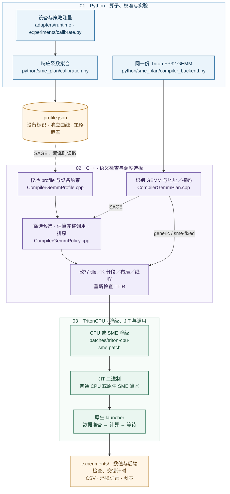
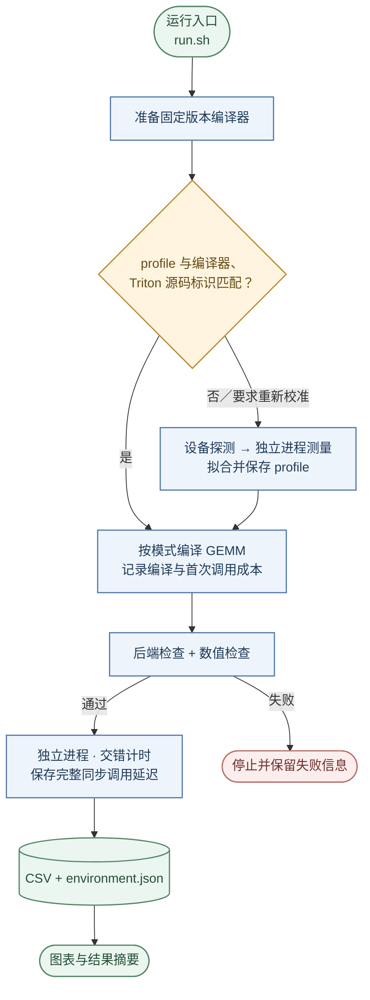

<a id="readme-top"></a>


<div align="center">
  <h1>🌠 SAGE</h1>
  <p><strong>面向 Arm SME 的 TritonCPU FP32 GEMM 调度扩展</strong></p>
  <p>设备校准 · C++ 成本模型 · 编译器生成原生 SME 代码</p>
  <a href="docs/model.md"><strong>模型与实现 »</strong></a>
  <br><br>
  <a href="#quickstart">快速上手</a> ·
  <a href="docs/experiments.md">实验指南</a> ·
  <a href="https://github.com/LulietLyan/SAGE/issues">问题与建议</a>
</div>

<p align="center">
  <a href="LICENSE"></a>
  <a href="https://github.com/LulietLyan/SAGE/stargazers"></a>
  
  
  
</p>


# 📕 目录

- [🤔 项目背景](#background)
- [🏗️ 架构与流程](#architecture)
- [📐 数学建模](#model)
- [😋 快速上手指南](#quickstart)
- [🧩 项目结构](#structure)
- [❓ 待办事项](#roadmap)
- [🤝 代码贡献](#contributing)
- [❓ 联系作者](#contact)
- [❗ 授权说明](#license)

<a id="background"></a>

# 🤔 项目背景

**SAGE** 为 [TritonCPU](https://github.com/triton-lang/triton-cpu) 增加基于设备校准的 GEMM 调度与原生 [Arm Scalable Matrix Extension（SME）](https://learn.arm.com/learning-paths/cross-platform/multiplying-matrices-with-sme2/3-streaming-mode/) 代码生成。同一份 Triton 矩阵乘法，通过不同编译模式比较普通 CPU 路径、固定 SME 调度和成本模型选择的调度。

当前原生路径面向 **macOS / Apple arm64，要求可执行 SME 且 streaming vector length（SVL）为 512 位**。已有目标设备为 Apple M4；其他操作系统、设备和数据类型尚未验证。Arm v9 名称本身不足以保证该实现可用，实际能力由探测程序和运行时检查确定。见[构建说明](patches/README.md)。

## 设计理念

- **调度属于编译器**：Python 离线测量与拟合；C++ 检查 GEMM 语义、筛选合法候选并排序。
- **计时覆盖完整调用**：每次所需的数据打包、复制、任务提交和等待均计入稳态延迟；编译与首次调用单独记录。
- **保留测量记录**：保存调度参数、数值误差、JIT 二进制标识和 `fmopa` 检查结果。

| 方法 | 行为 |
| --- | --- |
| `generic` | 普通 TritonCPU 数值降级，不生成 SME 算术。 |
| `sme-fixed` | 固定 `128 × 256 × 16` 分块、原始 B 布局和调用方线程预算。 |
| **SAGE** | C++ 选择 CPU 或 SME、分块、K 分段、A 打包、B 布局及线程数。 |
| `pytorch` | 独立的 PyTorch 基线，记录实际入口、版本与线程配置。 |

原生 SME 算术生成在 Triton JIT 二进制内。当前编译入口识别静态、连续、行主序 FP32 GEMM；SME 改写要求各维度至少为 32，并检查输出与输入不重叠。CPU/SME 混合执行、任意步长布局和自动算子融合尚未实现。Attention、KAN、SwiGLU、Linear、BMM 是应用层实验，见[实验范围](docs/experiments.md)。

<a id="architecture"></a>

# 🏗️ 架构与流程

## 模块架构

Python 提供算子、校准与实验入口；C++ 在编译时决定调度；TritonCPU 补丁负责降级和原生执行。`profile.json` 记录响应系数及测量覆盖，供 SAGE 选择调度。



## 一次实验如何完成

构建、校准、编译和首次调用单独记录，稳态性能使用之后的测量。SME 路径还需通过指令检查与数值检查。



上图描述默认 GEMM 流程。`--plot-only` 直接读取已有结果；各应用算子的进程数、窗口和准备边界见[实验指南](docs/experiments.md)。

<a id="model"></a>

# 📐 数学建模

模型在合法调度中选择**预测完整调用时间最短**的方案。这里给出任务划分、成本估计和校准方法；所有权证明、FP32 误差分析与摊销推导见[模型文档](docs/model.md)。

## 1. 从算子语义建立可行集

对 $A\in\mathbb F_{32}^{M\times K}$、$B\in\mathbb F_{32}^{K\times N}$，要求覆盖写入

$$
C_{ij}=\sum_{k=0}^{K-1}A_{ik}B_{kj},\qquad
\theta^*=\arg\min_{\theta\in\mathcal F}\widehat T(\theta).
$$

调度 $\theta=(e,B_M,B_N,B_K,K_c,a,\ell,p)$ 分别表示执行路径、三个分块维度、K 面板容量、A 打包方式、B 布局和线程数。[C++ 策略](lib/Core/CompilerGemmPolicy.cpp) 根据静态 GEMM 语义、地址与资源限制、profile 兼容性和已测策略范围构造可行集 $\mathcal F$。

## 2. 从分块推导任务数、计算量与流量

令 $c_M=\lceil M/B_M\rceil$、$c_N=\lceil N/B_N\rceil$，则

$$
J=c_Mc_N,\quad L=\lceil J/p\rceil,\quad
\eta=J/(Lp),\quad z=\lceil K/K_c\rceil.
$$

$J$ 是输出任务数，$L$ 是模型中的波次数，$\eta$ 修正最后一波未填满的情况，$z$ 是顺序 K 分段数。每个输出 tile 由一个任务持有，跨段重载部分和；分段增加 C 的读写，但不改变输出所有权。

对于 32×32 SME 微内核，取 $\overline M=32\lceil M/32\rceil$、$\overline N=32\lceil N/32\rceil$：

$$
\begin{aligned}
F&=2\overline M\,\overline N K,\\
R&=4\overline M K\lceil N/32\rceil
  +4NK\lceil M/32\rceil+4MN(2z-1).
\end{aligned}
$$

$F$ 近似执行的算术工作，$R$ 近似微内核边界的操作数加载与 C 读写，包含可能命中缓存的重复加载；它不是测得的 DRAM 流量。

## 3. 将计算、准备与调度合成完整调用成本

令 $P_p$ 为线程组算术响应，$\beta_{p,f}(S)$ 为精确策略家族 $f$ 在面板容量 $S$ 下的操作数响应；$a_{p,a},b_p,g_p$ 为 A 打包、局部 B 复制和全局 B 复制速率。当前 [C++ 估计器](lib/Core/CompilerGemmPolicy.cpp) 为

$$
\begin{aligned}
\widehat T_{\mathrm{SME}}={}&
\max\!\left\{\frac{F}{\eta P_p\phi_B},
             \frac{R}{\eta\beta_{p,f}(S)\phi_B}\right\}\\
&+\frac{8MKc_N}{\eta a_{p,a}\phi(K)}
 +\mathbf1_{\ell=\mathrm{local}}\frac{8c_MKN}{\eta b_p\phi(N)}\\
&+\mathbf1_{\ell=\mathrm{global}}\frac{8KN}{g_p\phi(N)}
 +h_p+J\tau_p+L\rho_p+Lz\sigma_p.
\end{aligned}
$$

| 成本 | 为什么存在 |
| --- | --- |
| `max` 项 | 以算术响应和操作数响应中的较慢分支估计计算区域。 |
| A 打包 | 每个 N 方向宏块都准备自己的 A 面板，因此乘 $c_N$。 |
| 局部 / 全局 B 复制 | 局部布局每个 M 方向宏块复制；全局布局每次调用复制一次。 |
| $h_p+J\tau_p+L\rho_p+Lz\sigma_p$ | 调用、任务提交、有效波次通信与分段开销。 |

时间单位为 ns，速率按整个线程组计，不再乘线程数。$\phi(d)$ 为步长惩罚，$\phi_B$ 使用当前 B 布局的实际行跨度。**2048 列整数倍使用固定 `0.40` 惩罚**，即使没有对应测量记录也会应用。这是当前实现保留的启发式。

CPU 候选使用逻辑 $F=2MNK$、$R=4(MK+KN+MN)$ 和相同调度结构，不含 SME 打包项。其内存响应当前借用合并后的 SME 响应近似，详见[模型限制](docs/model.md#4-校准与适用域)。

## 4. 用独立校准拟合响应，再选择调度

[Python 校准](python/sme_plan/calibration.py) 从完整调用中扣除已知准备与调度项，得到残差 $r$：

$$
r=T_{\mathrm{call}}-T_{\mathrm{known}},\qquad
\beta_{\mathrm{obs}}=\frac{R}{\eta r},\qquad
P_{\mathrm{obs}}=\frac{F}{\eta r}.
$$

仅足够大的正残差参与拟合。响应按线程组及精确 tile／打包／布局／完整或分段 K 家族保存，在对数面板容量坐标上线性插值；分段候选不得超出已测容量区间。C++ 读取这些系数，对可行候选计算 $\widehat T$ 并确定性排序。

两种响应来自同一残差，无法分别识别算术峰值和物理带宽；校准扣除也未包含 C++ 的步长修正。模型的排序效果由后续实验检验，实测吞吐量使用 **逻辑 $2MNK/T_{\mathrm{measured}}$**。CPU/SME 混合执行尚未实现，其假设与设置成本摊销见[补充分析](docs/model.md#5-保留的条件性分析)。

<p align="right">(<a href="#readme-top">返回顶部</a>)</p>

<a id="quickstart"></a>

# 😋 快速上手指南

## 克隆仓库

```bash
git clone https://github.com/LulietLyan/SAGE.git
cd SAGE
```

## 开始项目

在支持 SME 的目标 Mac 上准备 Xcode Command Line Tools、Python 3.11+ 及兼容的 CPU PyTorch。构建工具可通过 Homebrew 安装：

```bash
brew install cmake ninja llvm libomp
./run.sh --quick       # 构建、按需校准，再做缩减 GEMM 测量
./run.sh               # 完整 GEMM 测量、绘图与汇总
./run.sh --test        # 独立策略、校准及原生运行时检查
```

`run.sh` 创建 `.venv/` 并安装实验依赖；首次选择解释器可用 `PYTHON=/path/to/python3 ./run.sh --quick`。首次构建会下载固定版本的 LLVM/MLIR、TritonCPU、SLEEF 等依赖，需要数 GB 空间。`--quick` 只缩减正式测量，**不缩减首次构建或校准**。

```bash
./run.sh --attention --quick
./run.sh --kan --quick
./run.sh --swiglu --quick
./run.sh --suite-v2 --quick       # 密集 GEMM、Linear 与 BMM
./run.sh --recalibrate           # 重新校准后测量
./run.sh --plot-only             # 从已有 GEMM 结果重绘
./run.sh --attention --plot-only # 从已有 Attention 结果重绘
```

默认产物位于本仓库的 **`output/`**，依赖与编译缓存位于 **`.build/`**，均不提交到 Git。使用 `--output /path/to/results` 指定结果目录；同名实验会更新已有结果，需保留多次测量时请使用不同目录。旧 profile 只有在编译器与 Triton 源码标识匹配时才会复用。

详细步骤、输出文件及测量口径见[实验指南](docs/experiments.md)；固定版本与工具链要求见[补丁说明](patches/README.md)。

<a id="structure"></a>

# 🧩 项目结构

| 路径 | 职责 |
| --- | --- |
| [`include/sme_plan/`](include/sme_plan/) · [`lib/Core/`](lib/Core/) | 独立 C++ 事实描述、候选约束与成本策略。 |
| [`adapters/triton_cpu/`](adapters/triton_cpu/) | TTIR 语义识别、调度改写与 profile 校验。 |
| [`adapters/runtime/`](adapters/runtime/) | SME 可执行性探测与原生设备校准。 |
| [`patches/`](patches/) | 固定 TritonCPU 版本上的方言、降级与 launcher 补丁。 |
| [`python/sme_plan/`](python/sme_plan/) | Triton GEMM、校准拟合与编译结果检查。 |
| [`experiments/`](experiments/) | 算子测量、诊断和绘图。 |
| [`scripts/`](scripts/) · [`tests/`](tests/) | 构建与实验入口、C++ / Python / 原生运行时测试。 |
| [`docs/`](docs/) | 模型、实验协议与开发说明。 |

<a id="roadmap"></a>

# ❓ 待办事项

- [x] 原生 SME GEMM、设备校准及 C++ 调度选择。
- [x] 完整调用计时、数值与实际后端检查。
- [ ] 验证更多设备与操作系统，明确各自的 SVL 和运行时约束。
- [ ] 独立验证步长启发式和 CPU 内存响应近似的适用范围。
- [ ] 扩展数据类型、布局与算子支持，并补充对应正确性验证。

<a id="contributing"></a>

# 🤝 代码贡献

欢迎通过 Issue 提交复现信息，或 Fork 后提交 Pull Request。性能相关改动请附设备信息、校准标识、完整调用计时和数值检查结果。格式约定、测试入口及补丁维护方式见[开发指南](docs/development.md)。

## 代码贡献人员

<a href="https://github.com/LulietLyan/SAGE/graphs/contributors">
  
</a>

<a id="contact"></a>

# ❓ 联系作者

- **项目维护者**：[@LulietLyan](https://github.com/LulietLyan)
- **问题与建议**：[GitHub Issues](https://github.com/LulietLyan/SAGE/issues)

<a id="license"></a>

# ❗ 授权说明

项目代码采用 [MIT License](LICENSE)。Triton 的许可与归属信息保留在 [LICENSE.triton](LICENSE.triton)；下载的依赖遵循各自的许可证。README 沿用作者的 [README-Template](https://github.com/LulietLyan/README-Template) 版式。

<p align="right">(<a href="#readme-top">返回顶部</a>)</p>

